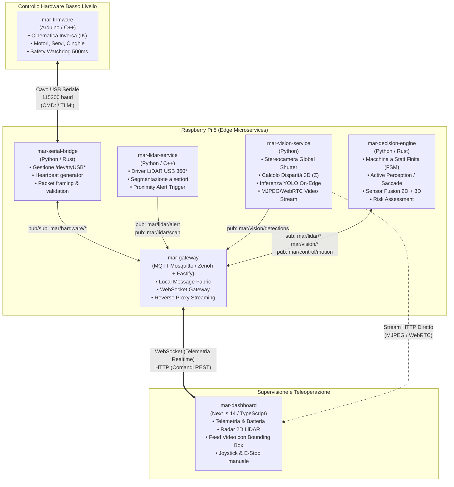
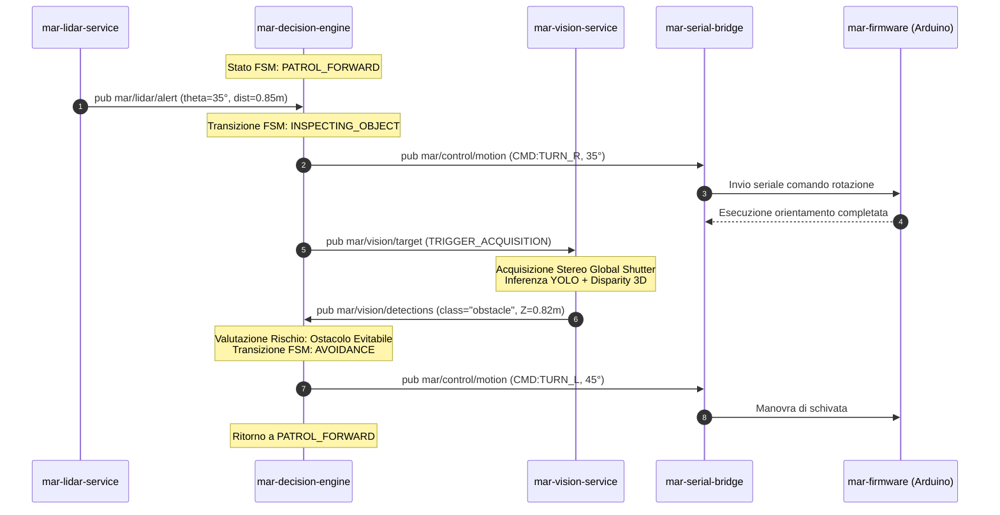
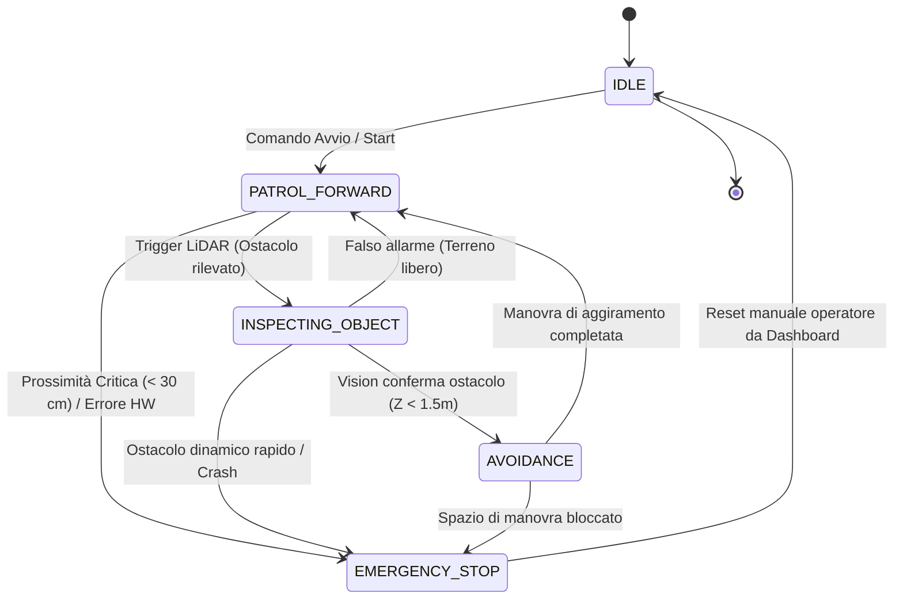
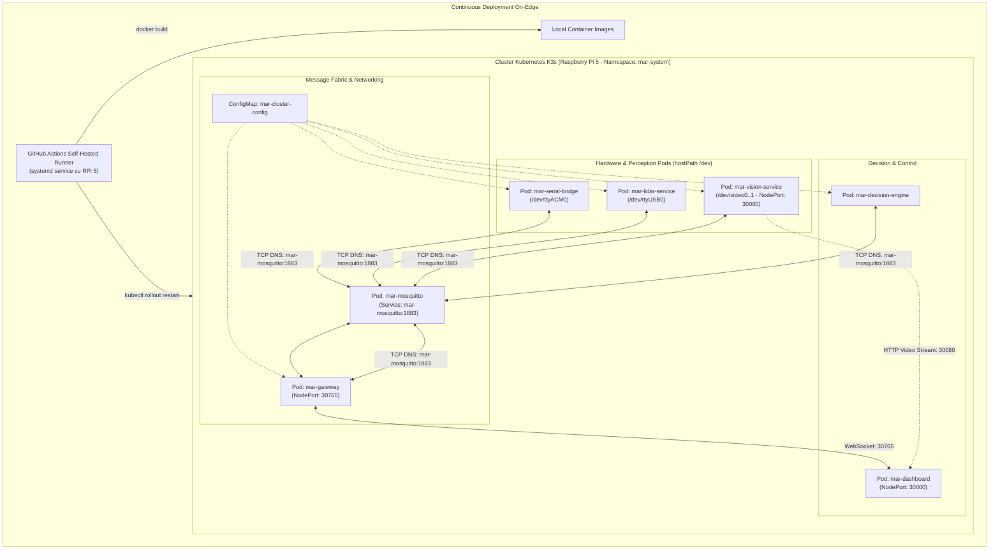
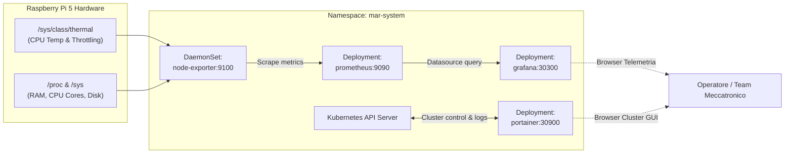

# M.A.R. — Architettura di Sistema a Microservizi

**Multi-legged Autonomous Robot con Percezione Attiva 3D, LiDAR e AI On-Edge**  
*Documento di Specifica Architetturale e Suddivisione Multi-Repository*

---

## Indice

1. [Visione e Principi Guida](#1-visione-e-principi-guida)
2. [Perché un'Architettura a Microservizi & Multi-Repository?](#2-perché-unarchitettura-a-microservizi--multi-repository)
3. [Architettura Logica Generale](#3-architettura-logica-generale)
4. [Dettaglio dei Microservizi (Specifiche per Repository)](#4-dettaglio-dei-microservizi-specifiche-per-repository)
   - [4.1 mar-firmware (Low-Level Gait & Actuation)](#41-mar-firmware-low-level-gait--actuation)
   - [4.2 mar-serial-bridge (Hardware Abstraction Layer)](#42-mar-serial-bridge-hardware-abstraction-layer)
   - [4.3 mar-lidar-service (2D Perception & Perimetral Scanner)](#43-mar-lidar-service-2d-perception--perimetral-scanner)
   - [4.4 mar-vision-service (3D Stereo Depth & Edge AI)](#44-mar-vision-service-3d-stereo-depth--edge-ai)
   - [4.5 mar-decision-engine (Core Brain, FSM & Active Perception)](#45-mar-decision-engine-core-brain-fsm--active-perception)
   - [4.6 mar-gateway (Inter-Service Message Broker & Telemetry Gateway)](#46-mar-gateway-inter-service-message-broker--telemetry-gateway)
   - [4.7 mar-dashboard (Web UI di Controllo e Telemetria)](#47-mar-dashboard-web-ui-di-controllo-e-telemetria)
5. [Protocolli di Comunicazione Inter-Servizio](#5-protocolli-di-comunicazione-inter-servizio)
   - [5.1 Event Bus Pub/Sub (MQTT / Zenoh)](#51-event-bus-pubsub-mqtt--zenoh)
   - [5.2 Protocollo Seriale RPi 5 ↔ Arduino](#52-protocollo-seriale-rpi-5--arduino)
   - [5.3 Flusso Video ad Alto Throughput](#53-flusso-video-ad-alto-throughput)
   - [5.4 Canale WebSocket verso la UI](#54-canale-websocket-verso-la-ui)
6. [Pipeline di Percezione Attiva (Active Perception / Saccade)](#6-pipeline-di-percezione-attiva-active-perception--saccade)
7. [Macchina a Stati Finita (Safety FSM)](#7-macchina-a-stati-finita-safety-fsm)
8. [Strategia di Deployment su Raspberry Pi 5](#8-strategia-di-deployment-su-raspberry-pi-5)
9. [Piano di Migrazione dal Monolito Attuale](#9-piano-di-migrazione-dal-monolito-attuale)

---

##1. Visione e Principi Guida

Il progetto **M.A.R.** realizza una piattaforma robotica quadrupede autonoma bio-ispirata capace di navigare in ambienti complessi e non strutturati. Il sistema implementa una strategia di **Percezione Attiva (Active Perception)** simile alla vista animale: monitoraggio a 360° continuo tramite sensore a basso costo computazionale (LiDAR), scatto saccadico dell'attenzione verso l'anomalia e comprensione 3D semantica ad alta precisione tramite stereocamera e reti neurali YOLO on-edge.

I principi cardine del sistema sono:
* **Fault Isolation (Isolamento dei guasti)**: un blocco o crash del motore AI non deve mai compromettere la stabilità fisica del quadrupede o bloccare i meccanismi di emergenza.
* **Separazione delle scale temporali**:
  * *Hard Real-Time (100–1000 Hz)*: anelli di controllo PID motori, cinematica inversa, gait balance.
  * *Soft Real-Time (10–30 Hz)*: acquisizione sensori perimetrali, ponte seriale, elaborazione frame.
  * *Asincrono / Event-driven*: decision making, classificazione semantica, telemetria verso UI.
* **Modularità e Indipendenza di Stack**: linguaggi e runtime differenti (C++, Python, TypeScript/Node.js) scelti per massimizzare le performance nel loro dominio specifico.

---

##2. Perché un'Architettura a Microservizi & Multi-Repository?

Nel design iniziale, script monolitici Python combinavano acquisizione camera, inferenza YOLO, lettura LiDAR, I/O seriale e server web all'interno dello stesso ciclo di esecuzione. Questa impostazione presentava criticità:
1. **Accoppiamento del ciclo FPS**: se l'inferenza di profondità stereo impiega 80 ms, l'invio dei comandi di movimento e la lettura della telemetria subiscono un jitter inaccettabile.
2. **Crash cascading**: un'eccezione non gestita nella decodifica video bloccherebbe il programma principale, portando Arduino in timeout di sicurezza.
3. **Conflitti di dipendenze**: librerie di computer vision (Torch, OpenCV, CUDA/NCNN) presentano requisiti di ambiente molto complessi rispetto a semplici demoni di I/O seriale o broker di rete.
4. **Lavoro in team parallelo**: il team meccatronico/elettronico deve poter aggiornare il firmware e il protocollo senza toccare il repository del modello di machine learning o quello della dashboard Next.js.

La scomposizione in **microservizi con repository dedicate** risolve radicalmente questi problemi.

---

##3. Architettura Logica Generale



---

##4. Dettaglio dei Microservizi (Specifiche per Repository)

###4.1 `mar-firmware` (Low-Level Gait & Actuation)
* **Descrizione**: Firmware bare-metal / RTOS che risiede sulla scheda microcontrollore.
* **Target Hardware**: Microcontrollore a 32-bit (Arduino GIGA R1 / Teensy 4.1 / RP2040 / Arduino Mega).
* **Stack**: C++17, PlatformIO / Arduino Core.
* **Responsabilità principali**:
  * Implementazione della **Cinematica Inversa analitica (IK)** a 3 gradi di libertà per zampa (12 DOF totali: 4 motori spinta anca, 4 trasmissioni a cinghia per ginocchia, 4 servomotori per apertura laterale/adduzione).
  * Generatore di andature (Gait Pattern Generator): *Trot* (trotto diagonale), *Crawl* (passo lento staticamente stabile a 3 punti d'appoggio), *Stand* (assetto eretto regolabile in altezza), *Sit* (appoggio a terra di parcheggio).
  * Controllo di posizione/velocità con anelli PID per i driver motori (PWM/DIR o bus CAN/RS485).
  * Lettura e filtraggio sensori di bordo: tensione batteria (BMS), sensori di corrente shunt, IMU a 6 assi per stima roll/pitch, microinterruttori di contatto piede.
  * **Watchdog di sicurezza hardware**: timer che azzera la velocità dei motori se non viene ricevuto un comando valido da `mar-serial-bridge` per più di 500 ms.
* **Repository suggerita**: `github.com/mar-robotics/mar-firmware`

---

###4.2 `mar-serial-bridge` (Hardware Abstraction Layer)
* **Descrizione**: Demone leggero incaricato della comunicazione seriale deterministica verso il microcontrollore.
* **Target Hardware**: Raspberry Pi 5.
* **Stack**: Python 3.11+ (con `pyserial`, `asyncio`) o Rust.
* **Responsabilità principali**:
  * Riconnessione automatica e riaggancio dinamico della porta seriale USB (`/dev/ttyACM*` o `/dev/ttyUSB*`).
  * Thread con priorità real-time dedicato alla generazione di **Heartbeat periodico (10–20 Hz)** verso Arduino.
  * Parsing e validazione di checksum dei pacchetti telemetrici in uplink (`TLM:...`) e pubblicazione sul Message Broker locale.
  * Acquisizione del sensore inerziale **MPU-6050 / GY-521** sul bus I2C (`/dev/i2c-1`, `0x68`) e pubblicazione dei campioni grezzi su `mar/imu/raw`.
  * Ricezione asincrona dei comandi di movimento (`mar/control/motion`) e trasduzione nei frame seriali downlink conformi alle specifiche.
* **Repository suggerita**: `github.com/mar-robotics/mar-serial-bridge`

---

###4.3 `mar-lidar-service` (2D Perception & Perimetral Scanner)
* **Descrizione**: Servizio per la lettura ad alta frequenza del sensore LiDAR a scansione continua 360°.
* **Target Hardware**: Raspberry Pi 5 (collegamento LiDAR USB 2.0/3.0).
* **Stack**: Python / C++ (libreria RPLIDAR o YDLidar SDK).
* **Responsabilità principali**:
  * Acquisizione del flusso continuo di campioni polari `(angolo, raggio, qualità)`.
  * Filtraggio e rimozione outlier (riflessioni spurie, punti a intensità debole).
  * Segmentazione spaziale a settori: *Frontale, Anteriore Sinistro, Anteriore Destro, Laterale Sinistro, Laterale Destro, Posteriore*.
  * **Proximity Alert Engine**: calcolo della distanza minima in ciascun settore rispetto a una soglia configurabile ($D < D_{\text{soglia}}$).
  * Pubblicazione dell'evento di trigger `mar/lidar/alert` contenente l'angolo $\theta_{\text{target}}$ per l'Active Perception.
  * Generazione di un pacchetto compresso 2D Radar Point Cloud (5–10 Hz) per la Dashboard.
* **Repository suggerita**: `github.com/mar-robotics/mar-lidar-service`

---

###4.4 `mar-vision-service` (3D Stereo Depth & Edge AI)
* **Descrizione**: Modulo a elevato carico computazionale per l'elaborazione video stereoscopica e l'inferenza di deep learning.
* **Target Hardware**: Raspberry Pi 5 (con accelerazione NEON, NCNN / ONNX Runtime).
* **Stack**: Python 3.11+, OpenCV 4.x, Ultralytics YOLO (o esportazione C++ NCNN), NumPy.
* **Responsabilità principali**:
  * Acquisizione sincronizzata da **Stereocamera Global Shutter** USB 3.0 (nessuna distorsione da movimento veloce).
  * Rettificazione stereo e calcolo della mappa di disparità tramite algoritmo `StereoSGBM` (Semi-Global Block Matching).
  * Inferenza YOLO on-edge (modelli `yolov8n` o custom quantizzati INT8/FP16) per il rilevamento di classi: *persone, animali, ostacoli rigidi, gradini, buche/dislivelli*.
  * **3D Coordinate Projection**: trasformazione del centro del bounding box 2D $(u, v)$ e della disparità nella coordinata metrica reale $(X, Y, Z)$ nello spazio del robot.
  * Streaming video annotato verso i client di supervisione (endpoint HTTP MJPEG o canale WebRTC a bassa latenza).
* **Repository suggerita**: `github.com/mar-robotics/mar-vision-service`

---

###4.5 `mar-decision-engine` (Core Brain, FSM & Active Perception)
* **Descrizione**: L'orchestratore decisionale autonomo del robot.
* **Target Hardware**: Raspberry Pi 5.
* **Stack**: Python 3.11+ o Rust.
* **Responsabilità principali**:
  * Gestione della **Macchina a Stati Finita (Safety FSM)** del robot (`IDLE`, `PATROL_FORWARD`, `INSPECTING_OBJECT`, `AVOIDANCE`, `EMERGENCY_STOP`).
  * Implementazione della logica di **Percezione Attiva (Saccade)**:
    1. Riceve l'azimut $\theta_{\text{target}}$ da `mar-lidar-service`.
    2. Comanda il puntamento della testa (o la rotazione del quadrupede sul posto verso l'angolo $\theta$).
    3. Abilita la scansione ad alta definizione di `mar-vision-service` con filtro sul motion-blur.
  * Valutazione del rischio (**Risk Assessment**): combinazione della classe rilevata con la distanza reale $Z$ (es. persona in avvicinamento vs sedia statica).
  * **Fusione inerziale**: filtro di Kalman a quaternioni sui campioni `mar/imu/raw`, calibrazione automatica dei bias e controllo di assetto (roll/pitch) per arresto su inclinazione critica e gestione di salite/discese.
  * Pianificazione reattiva della via di fuga (*Obstacle Avoidance*): selezione della direzione libera con maggior clearance laterale.
  * Invio delle direttive al ponte seriale (`mar/control/motion`).
* **Repository suggerita**: `github.com/mar-robotics/mar-decision-engine`

---

###4.6 `mar-gateway` (Inter-Service Message Broker & Telemetry Gateway)
* **Descrizione**: La spina dorsale di comunicazione del sistema robotico.
* **Target Hardware**: Raspberry Pi 5.
* **Stack**: Eclipse Mosquitto (MQTT Broker) affiancato da un gateway Node.js/Fastify o Python FastAPI (WebSocket server).
* **Responsabilità principali**:
  * Fornisce il bus messaggi Pub/Sub interno a bassissimo overhead di memoria e CPU.
  * Mantiene la connessione WebSocket bidirezionale con la `mar-dashboard`.
  * Instrada la telemetria aggregata (batteria, pitch/roll, point cloud LiDAR, log eventi AI).
  * Gestione dei comandi prioritari inviati dall'operatore: switch da modalità `AUTONOMOUS` a `MANUAL_TELEOP`, joystick virtuale e pulsante prioritario di `EMERGENCY_STOP`.
  * **Link telemetrico Long-Range LoRa (868 MHz)**: aggregazione di assetto, distanza frontale, batteria e stato FSM in un frame compatto verso la stazione di terra, con backend RFM95W su SPI o Waveshare SX1262 su USB.
* **Repository suggerita**: `github.com/mar-robotics/mar-gateway`

---

###4.7 `mar-dashboard` (Web UI di Controllo e Telemetria)
* **Descrizione**: Interfaccia web reattiva multipiattaforma (PC, tablet o mobile) per l'operatore umano.
* **Target Hardware**: Browser operatore (servita da RPi 5 o eseguita su postazione remota).
* **Stack**: Next.js 14, React, TypeScript, Tailwind CSS, Lucide Icons, Zustand, Prisma.
* **Responsabilità principali**:
  * Visualizzazione streaming video stereoscopico in tempo reale con overlay dei bounding box e distanze stimate.
  * Widget radar interattivo 2D a 360° per la visualizzazione dei campioni LiDAR.
  * Strumentazione digitale di bordo: voltmetro batteria, amperometro, indicatore di assetto artificiale (orizzonte artificiale per roll/pitch), stato di salute dei nodi.
  * Console di teleoperazione manuale: joystick virtuale, selettore andature (*Trot, Crawl, Stand, Sit*), pulsante rosso di arresto d'emergenza (E-Stop).
  * Log in tempo reale delle decisioni prese dalla FSM.
* **Origine attuale**: già sviluppata nella directory [dashboard-mar-quadrupede](file:///Users/gianluca/Desktop/m.a.r./dashboard-mar-quadrupede/).
* **Repository suggerita**: `github.com/mar-robotics/mar-dashboard`

---

##5. Protocolli di Comunicazione Inter-Servizio

###5.1 Event Bus Pub/Sub (MQTT / Zenoh)

Tutti i microservizi locali su Raspberry Pi 5 comunicano tramite topic standardizzati:

| Topic | Tipo | Payload Esempio | Descrizione |
| :--- | :--- | :--- | :--- |
| `mar/lidar/alert` | Evento | `{"theta": 32.5, "dist_m": 0.85, "sector": "FRONT_RIGHT"}` | Trigger di prossimità ostacolo per la Saccade |
| `mar/lidar/scan` | Flusso | `{"timestamp": 1728940000, "points": [[0.5, 30], ...]}` | Campioni LiDAR ridotti per visualizzazione radar |
| `mar/vision/target` | Comando | `{"action": "CAPTURE_TARGET", "fov_center_deg": 32.5}` | Richiesta scatto/analisi stereo mirata |
| `mar/vision/detections` | Evento | `{"count": 1, "objects": [{"class": "box", "z_m": 0.82, "conf": 0.88}]}` | Riconoscimento semantico e distanza 3D |
| `mar/fsm/state` | Stato | `{"state": "AVOIDANCE", "target_theta": -25.0}` | Stato corrente del Decision Engine |
| `mar/control/motion` | Comando | `{"cmd": "TURN_L", "param": 30}` | Direttiva di movimento per il ponte seriale |
| `mar/hardware/telemetry` | Flusso | `{"batt_v": 11.8, "curr_a": 4.2, "pitch": 1.2, "roll": -0.8}` | Dati fisici dal microcontrollore ad alta frequenza |
| `mar/imu/raw` | Flusso | `{"gyro": [120, -35, 8], "acc": [180, -240, 16200], "gyro_scale": 131.0, "accel_scale": 16384.0}` | Campioni IMU grezzi (MPU-6050, 100 Hz) dal ponte seriale |
| `mar/imu/status` | Stato | `{"available": true, "reason": "MPU-6050 attiva su /dev/i2c-1"}` | Disponibilità del sensore inerziale |
| `mar/imu/telemetry` | Flusso | `{"roll": 1.2, "pitch": -0.8, "yaw": 45.0, "calibrated": true}` | Assetto filtrato con Kalman a quaternioni |
| `mar/lora/status` | Stato | `{"backend": "spi", "tx_count": 42, "last_frame": "[IMU] ..."}` | Salute del link radio long-range 868 MHz |
| `mar/lora/rx` | Evento | `{"payload": "CMD:STOP"}` | Frame ricevuti dalla stazione di terra via LoRa |
| `mar/safety/estop` | Prioritario | `{"source": "DASHBOARD_BUTTON", "reason": "OPERATOR_OVERRIDE"}` | Comando prioritario di blocco istantaneo |

---

###5.2 Protocollo Seriale RPi 5 ↔ Arduino

Il collegamento fisico avviene su cavo schermato USB a **115200 baud** (o 230400 baud) con delimitatore di fine riga `\n`:

####Downlink (RPi 5 -> Arduino)
* `CMD:STOP\n`: Arresto immediato dei motori e assetto bilanciato.
* `CMD:FORWARD,<0-100>\n`: Avanzamento con velocità percentuale nominale.
* `CMD:BACKWARD,<0-100>\n`: Movimento indietro.
* `CMD:TURN_L,<deg_or_speed>\n`: Rotazione sul posto a sinistra.
* `CMD:TURN_R,<deg_or_speed>\n`: Rotazione sul posto a destra.
* `CMD:STAND,<height_mm>\n`: Assetto eretto a un'altezza impostata.
* `CMD:SIT\n`: Parcheggio a riposo sul suolo.
* `CMD:HIP_WIDTH,<deg>\n`: Apertura angolare dei servomotori dell'anca.
* `CMD:PING\n`: Heartbeat di mantenimento del watchdog.

####Uplink (Arduino -> RPi 5)
* `TLM:STATUS=<OK|WARN|FAULT>,BATT=<volts>,CURR=<amps>,PITCH=<deg>,ROLL=<deg>\n`

---

###5.3 Flusso Video ad Alto Throughput
Per evitare di sovraccaricare il Message Broker con payload di immagini binarie ad alta frequenza (30–60 FPS), il flusso video non passa attraverso MQTT:
* `mar-vision-service` espone direttamente uno streaming endpoint HTTP (`/stream/stereo_left` o `/stream/annotated`) via **MJPEG** (o WebRTC).
* La `mar-dashboard` preleva il flusso direttamente dall'URL designato o tramite reverse proxy.

---

###5.4 Canale WebSocket verso la UI
Il servizio `mar-gateway` mantiene un canale WebSocket aperto con i client connessi, aggregando la telemetria hardware, i punti radar LiDAR e lo stato della FSM a intervalli di 100 ms (10 Hz), minimizzando la latenza percepita dall'operatore.

---

##6. Pipeline di Percezione Attiva (Active Perception / Saccade)



---

##7. Macchina a Stati Finita (Safety FSM)

La logica del `mar-decision-engine` garantisce un comportamento deterministico:



###Regole di Risk Assessment
* **Criticità 1 (Emergenza)**: $Z < 30\text{ cm}$ o perdita segnale sensori $\rightarrow$ `EMERGENCY_STOP` immediato.
* **Criticità 2 (Ostacolo Evitabile)**: $30\text{ cm} \le Z \le 150\text{ cm}$ $\rightarrow$ analisi dei settori liberi dal LiDAR e transizione in `AVOIDANCE` (`EVADE_LEFT` o `EVADE_RIGHT`).
* **Criticità 3 (Falso Allarme / Bersaglio Lontano)**: $Z > 150\text{ cm}$ o rilevazione nulla $\rightarrow$ `RESUME_FORWARD`.

---

## 8. Strategia di Deployment & Orchestrazione con Kubernetes (K3s on Edge)

Per gestire in modo affidabile, resiliente e scalabile il ciclo di vita dei microservizi su Raspberry Pi 5 (SO: Raspberry Pi OS a 64-bit / Debian Bookworm), il sistema adotta **Kubernetes** nella sua distribuzione edge-native certificata CNCF: **K3s**.

### 8.1 Perché Kubernetes (K3s) su Raspberry Pi 5?

1. **Gestione del Ciclo di Vita Dichiarativo**: riavvio automatico dei pod in caso di guasto (`restartPolicy: Always`), healthcheck periodici (liveness & readiness probes) e rolling update a zero downtime.
2. **Isolamento delle Risorse (cgroups v2)**: ogni pod dichiara limiti esatti di CPU e memoria RAM (fondamentale per evitare che l'inferenza YOLO saturi la memoria compromettendo il processo seriale con Arduino).
3. **Service Discovery e DNS Interno**: CoreDNS risolve automaticamente gli endpoint di rete dei pod tramite nomi di servizio standard (es. `mar-mosquitto.mar-system.svc.cluster.local`), senza dover codificare IP statici.
4. **Hardware Device Passthrough**: le periferiche fisiche USB (Arduino `/dev/ttyACM0`, LiDAR `/dev/ttyUSB0` e stereocamera `/dev/video*`) vengono mappate nei rispettivi pod in modo sicuro tramite volumi `hostPath` e contesti di sicurezza privilegiati.
5. **CI/CD Integrata con GitHub Self-Hosted Runners**: ogni volta che viene effettuato un push su una repository di un microservizio, un runner GitHub Actions locale su RPi compila l'immagine Docker ed esegue `kubectl rollout restart`, aggiornando il pod a caldo.



### 8.2 Struttura dei Manifest Kubernetes (`k8s/`)

Tutte le definizioni dichiarative sono organizzate nella cartella [`k8s/`](file:///Users/gianluca/Desktop/m.a.r./k8s):

| File Manifest | Risorse Kubernetes | Ruolo Architetturale |
| :--- | :--- | :--- |
| `namespace.yaml` | `Namespace: mar-system` | Isolamento logico di tutti i componenti del quadrupede |
| `configmap.yaml` | `ConfigMap: mar-cluster-config` | Configurazione centralizzata (host broker, porte, soglie) |
| `mosquitto.yaml` | `Deployment`, `Service: mar-mosquitto` | Broker MQTT per la comunicazione inter-servizio (porte 1883, 9001) |
| `gateway.yaml` | `Deployment`, `Service: mar-gateway` | Gateway WebSocket (porta 8765 / NodePort 30765) |
| `serial-bridge.yaml` | `Deployment: mar-serial-bridge` | Ponte seriale verso Arduino con accesso privilegiato a `/dev/ttyACM0` |
| `lidar-service.yaml` | `Deployment: mar-lidar-service` | Acquisizione LiDAR 360° con accesso a `/dev/ttyUSB0` |
| `vision-service.yaml` | `Deployment`, `Service: mar-vision-service` | Visione 3D, YOLO e video streaming (porta 8080 / NodePort 30080) |
| `decision-engine.yaml` | `Deployment: mar-decision-engine` | Macchina a stati FSM, Saccade e navigazione autonoma |
| `dashboard.yaml` | `Deployment`, `Service: mar-dashboard` | UI operatore Next.js 14 (porta 3000 / NodePort 30000) |
| `monitoring/node-exporter.yaml` | `DaemonSet`, `Service: node-exporter` | Esportatore metriche hardware RPi 5 (porta 9100) |
| `monitoring/prometheus.yaml` | `Deployment`, `Service: prometheus` | Database metriche time-series (porta 9090 / NodePort 30090) |
| `monitoring/grafana.yaml` | `Deployment`, `Service: grafana` | Dashboard telemetriche e grafici diagnostici (porta 3000 / NodePort 30300) |
| `monitoring/portainer.yaml` | `Deployment`, `Service: portainer` | Web GUI di gestione Kubernetes & container (porta 9000 / NodePort 30900) |
| `kustomization.yaml` | `Kustomization` | Raggruppamento e deploy atomico con `kubectl apply -k k8s/` |

### 8.3 Stack di Osservabilità, Monitoraggio & Cluster Management

La gestione operativa di un quadrupede autonomo on-edge richiede visibilità in tempo reale sia sullo stato del cluster software sia sulla salute termica ed elettrica dell'hardware:

1. **Portainer CE (Cluster & Container GUI - NodePort `30900`)**:
   - Accessibile via browser da PC/tablet senza bisogno di CLI o SSH.
   - Fornisce ispezione visiva dei pod, visualizzazione dei log aggregati, terminale interattivo con shell diretta nei container ed esecuzione di riavvii selettivi con 1 click.
2. **Prometheus (Metrics Engine - NodePort `30090`)**:
   - Raccoglie metriche ogni 5 secondi con una retention conservativa di 24 ore (< 200 MB su disco).
   - Scansiona automaticamente il `node-exporter` e tutti i pod Kubernetes provvisti di annotazione `prometheus.io/scrape: "true"`.
3. **Node Exporter (Hardware Telemetry RPi 5 - Porta `9100`)**:
   - Monitora la temperatura del SoC BCM2712 del Raspberry Pi 5, rilevando tempestivamente stati di **Thermal Throttling** durante l'elaborazione intensiva di YOLO.
   - Traccia carico CPU per core, memoria RAM allocata/libera e I/O su scheda microSD/NVMe.
4. **Grafana (Visualization & Alerting - NodePort `30300`)**:
   - Dashboard preconfigurata con connessione automatica a Prometheus.
   - Pannelli dedicati a:
     * *Hardware Health*: temperatura CPU, frequenza di clock, tensione/batteria.
     * *Pipeline AI*: FPS di inferenza stereoscopica, tempo di calcolo disparità.
     * *Comms Health*: throughput messaggi MQTT su `mar-mosquitto`, latenza heartbeat seriale verso Arduino.



### 8.4 Comandi Operativi di Gestione Kubernetes

```bash
# Applicare o aggiornare tutti i microservizi e la suite di monitoraggio
kubectl apply -k k8s/

# Ispezionare lo stato di tutti i pod (servizi + monitoraggio)
kubectl get pods,svc -n mar-system -o wide

# Portali di accesso Web di gestione:
# - Dashboard Operatore:   http://<IP_RPI>:30000
# - Grafana Monitor:       http://<IP_RPI>:30300 (admin / admin)
# - Portainer Cluster GUI: http://<IP_RPI>:30900
# - Video Stream MJPEG:    http://<IP_RPI>:30080/stream/left
```

---

##9. Piano di Migrazione dal Monolito Attuale

La cartella di lavoro corrente contiene codice prototipale da scorporare nelle rispettive nuove repository:

| Contenuto Attuale nel Workspace | Repository di Destinazione | Azione di Migrazione |
| :--- | :--- | :--- |
| `dashboard-mar-quadrupede/` | `mar-dashboard` | Spostare nella repository dedicata Next.js; configurare l'indirizzo WebSocket verso `mar-gateway`. |
| `stereocamera/` & `stereovisione/camera/`, `detector/` | `mar-vision-service` | Isolare l'acquisizione stereo e l'inferenza YOLO; integrare il publisher verso il broker MQTT. |
| `stereovisione/firmware/` & `stereovisione.ino` | `mar-firmware` | Creare progetto PlatformIO per microcontrollore con cinematica inversa completa e watchdog a 500 ms. |
| `stereovisione/comms/serial_bridge.py` | `mar-serial-bridge` | Estrarre e rifattorizzare come servizio stand-alone con heartbeat a ciclo fisso e client MQTT. |
| Nuova implementazione driver LiDAR | `mar-lidar-service` | Creazione del driver LiDAR USB con filtraggio outlier e trigger azimutale $\theta$. |
| `stereovisione/navigation/` | `mar-decision-engine` | Trasformare in macchina a stati FSM event-driven. |
| `canelidarstereoimudef2.py` + `IMUKalmanFilter.py` | `mar-decision-engine` | Logica decisionale e pitch control nella FSM; filtro di Kalman in `imu_filter.py` + `imu_fusion.py`. Lettura I2C MPU-6050 spostata in `mar-serial-bridge`. |
| `canelidarstereoimuloradef2.py` + `lorausb.py` | `mar-gateway` | Bridge LoRa 868 MHz (RFM95W SPI / Waveshare SX1262 USB) con telemetria aggregata verso la stazione di terra. |
| `lidar_cartesiane8OKDO_def.py` | `mar-lidar-service` | Parsing 0x54, offset +90°, 8 settori, filtri IQR/EMA già integrati nel driver di servizio. |
| `stereovisione_lidardef_calfiltri6.py` | `mar-vision-service` | Griglia 3D a 9 zone e disparità SGBM integrate (con auto-focus e sicurezza lenti) in `camera/stereo_depth.py`. |
| Nuova implementazione | `mar-gateway` | Configurazione broker MQTT Mosquitto e server WebSocket di smistamento. |

---

## 10. Accesso Operatore (LAN / Tailscale)

L'accesso ai servizi M.A.R. avviene in rete privata (LAN o **Tailscale**), senza esposizione pubblica su dominio personale.

| Servizio | NodePort | URL tipico via Tailscale |
| :--- | :--- | :--- |
| Dashboard operatore | `30000` | `http://100.72.15.72:30000` |
| Vision monitor / MJPEG | `30080` | `http://100.72.15.72:30080` |
| WebSocket gateway | `30765` | `ws://100.72.15.72:30765` |
| Grafana | `30300` | `http://100.72.15.72:30300` |
| Prometheus | `30090` | `http://100.72.15.72:30090` |
| Portainer | `30900` | `http://100.72.15.72:30900` |

> L'IP LAN del Raspberry Pi può variare via DHCP: usare sempre l'IP Tailscale del nodo (`dietpi`) per operazioni e CI/CD.

---

## 11. Pipeline Stereovisione 3D Integrata (`mar-vision-service`)

Il servizio `mar-vision-service` integra l'algoritmo di stereovisione e guida autonoma estratto da `stereovisione_robot.4py.py`, offrendo:
1. **Acquisizione Asincrona non bloccante**: Thread dedicato `LetturaCamera` con `Condition` variable e `CAP_PROP_BUFFERSIZE = 1` per azzerare la latenza del frame buffer. Supporto per montaggio sottosopra con rotazione automatica 180° (`cv2.flip(raw, -1)`).
2. **Allineamento Epipolare Verticale**: Compensazione software del disallineamento ottico verticale $\Delta Y$ tramite `stima_dy_epipolare` e matrice affine `M_epi`. Offset calibrati salvati in `calibrazione_offset.json` (`offset_x: -14`, `offset_y: 28`).
3. **Safety Engine & Lens Watchdog**: Monitoraggio in tempo reale della luminosità media, saturazione, varianza e freeze del sensore (`valuta_sicurezza_lenti`). In caso di copertura lenti, buio o freeze, scatta l'allarme immediato e la decisione `STOP`.
4. **Disparità SGBM & Auto-Focus Dinamico**:
   - **Modo 0**: Vista Stereo SBS (Sx e Dx)
   - **Modo 1**: Disparità stereoscopica raw in scala di grigi
   - **Modo 2**: Disparità con color mapping Jet ad alto contrasto
   - **Modo 3**: Ostacolo con Auto-Focus dinamico (inseguimento dell'offset $-disp_{mediana}$ con filtro esponenziale IIR a bassa frequenza).
   - **Auto-Switch**: Cambio automatico tra Modo 0 (distanze lunghe) e Modo 3 (ostacoli vicini $< 200\text{ cm}$) con isteresi di $15\text{ cm}$.
5. **Filtro di Densità e Corridoio 3D**: Ricostruzione tridimensionale proiettata nel corridoio di ingombro del quadrupede ($|X| \le 40\text{ cm}$, $Z \le 400\text{ cm}$). Filtraggio del rumore tramite `filtra_densita` e componenti connesse `isola_blob_compatto`.
6. **Mappa Top-Down 2D e Decisione di Guida**: Generazione di una mappa di navigazione dall'alto (450x450 px) con fascio guida verde e calcolo in tempo reale del comando di marcia:
   - `AVANTI`: Corridoio libero da ostacoli
   - `FRENA`: Ostacolo moderato nel corridoio o distanza intermedia
   - `STOP`: Ostacolo critico a terra ($< 45\text{ cm}$), ostacolo frontale ravvicinato o allarme sicurezza lenti.
   I comandi vengono pubblicati istantaneamente su MQTT topic `mar/vision/command`.

---

*Documento redatto per il progetto **M.A.R. — Multi-legged Autonomous Robot**.*  
*Per modifiche architetturali o proposte di estensione dei protocolli, sottomettere una RFC al team.*

